# Robot Labs Stand · ROS 2 + интерактивные ноутбуки

Учебный стенд по робототехнике: **одна математика в двух формах**.

1. **Интерактивные ноутбуки** (`notebooks/`) — 6 лабораторных (однородные
   координаты, SO(3), камера и стереопара, гомография/PnP/RANSAC, прямая и
   обратная кинематика) плюс сводный стенд «Апофеоз»: 41 задание с ползунками,
   графиками и числовыми проверками. Двигаете ползунок — формула задания
   пересчитывается заново.
2. **ROS 2-стенд** (`ros2_ws/`) — та же 4-шарнирная рука (yaw + 3 pitch,
   избыточность 1 DOF), тот же маркер и перелёт камеры, но вживую: URDF,
   дерево кадров tf2, RANSAC-трекинг, IK-сервер. Всё в Docker, одной командой,
   на любой машине — включая Apple Silicon.

**Мост** связывает оба мира: панель ноутбука двигает ту же руку в ROS 2.

Дальше по тексту — скриншоты всего функционала: что на экране, что нажать и
что должно получиться.

---

## Быстрый старт

Нужен только Docker (ROS 2 на хосте не нужен ни для чего).

```bash
git clone https://github.com/ipashab/robot-labs-stand
cd robot-labs-stand

# вариант А: полный живой стенд (трекинг + IK) и просмотрщик в браузере
docker compose -f docker/docker-compose.yml up -d --build stand viewer

# вариант Б: лёгкий мост под панель ноутбука (можно одновременно со стендом)
docker compose -f docker/docker-compose.yml up -d --build bridge

# → просмотрщик: http://localhost:8080
```

Порты и состав — в таблице ниже; `stand` и `bridge` можно держать запущенными
одновременно (у них разные ROS-домены, узлы не мешают друг другу).

| Сервис | Что поднимает | rosbridge | Мост ноутбука |
|---|---|---|---|
| `stand` | URDF + tf2, перелёт камеры, трекинг маркера (RANSAC), IK-сервер | `ws://localhost:9090` | `localhost:8977` |
| `bridge` | то же без трекинга и IK: суставы задаёт панель ноутбука | `ws://localhost:9190` | `localhost:8177` |
| `viewer` | Trillium в браузере с готовой раскладкой панелей | — | — |

Порты меняются переменными, если заняты:
`ROSBRIDGE_PORT=9091 docker compose -f docker/docker-compose.yml up -d stand`.

Ноутбуки без Docker:

```bash
python3 -m venv .venv && source .venv/bin/activate
pip install numpy sympy matplotlib ipywidgets jupyter voila
voila notebooks/Апофеоз_ЛР01-06.ipynb --port 8965    # откройте http://localhost:8965
```

Достаточно `numpy`, `sympy`, `matplotlib`, `ipywidgets`. В лабах 01–06
прикладные блоки (сверка с `pinocchio`, `cv2`) обёрнуты в
`try / except ImportError`: без этих библиотек блок печатает подсказку и
пропускается, остальное работает.

---

## Ноутбук-стенд: как выглядит

Открывается как страница (Voilà) или как обычный `.ipynb`. Сверху — таблица
лаб и требования, дальше — задания.

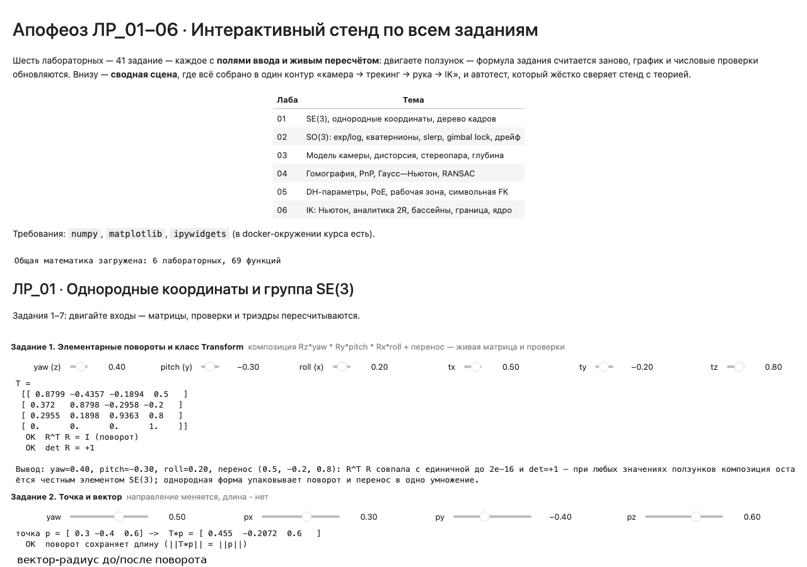

**ЛР_01 · Однородные координаты и SE(3).** Ползунки (yaw/pitch/roll и перенос)
собирают живую матрицу `T` со строчками `OK R^T R = I`, `OK det R = +1` (это на
титульном кадре выше). Ниже — точка и вектор до/после поворота: направление
меняется, длина остаётся (`||T*p|| = ||p||`); там же аксиомы группы — обратный,
замкнутость и `|AB − BA| = 0.491` (группа не абелева).

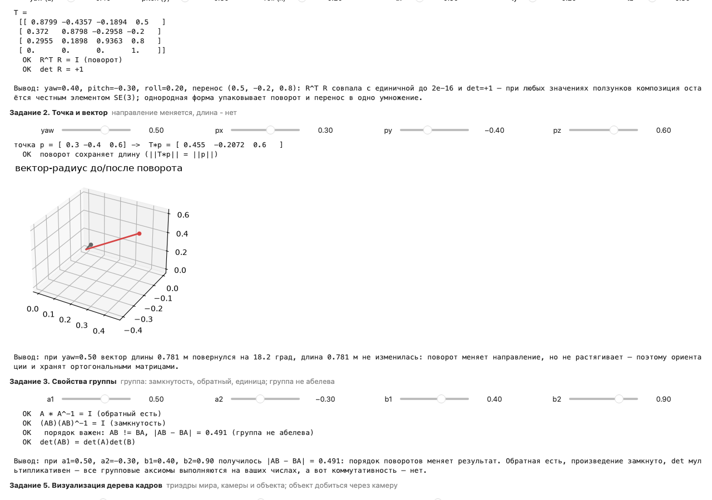

**ЛР_02 · SO(3).** Ползунок `pitch` у 89.5° — на графике видно, как `det(J)`
Эйлеров проваливается на 16 порядков у ±90°: это gimbal lock, а не баг кода.
Строчкой ниже — та же величина `|cos(pitch)|` (совпадают). Ниже — сравнение
`slerp` и линейной интерполяции Эйлеров на одном развороте.

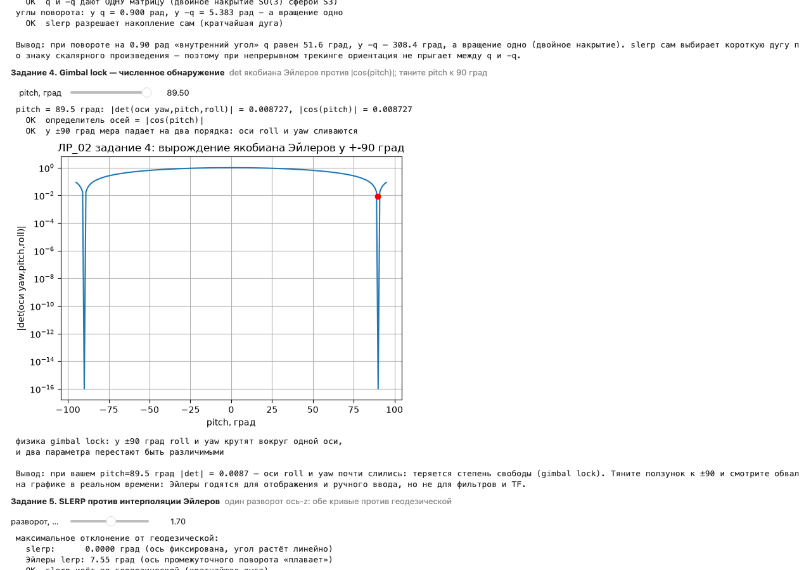

**ЛР_03 · Модель камеры.** Ползунки `f` и `Z` — масштаб `f/Z` (пикс/м) и размер
куба в пикселях меняются сразу; каркас куба собирается линейной проекцией
вручную, без 3D-библиотек. Ниже — сетка с дисторсией (`k1`, `k2`) и её
компенсация обратным преобразованием.

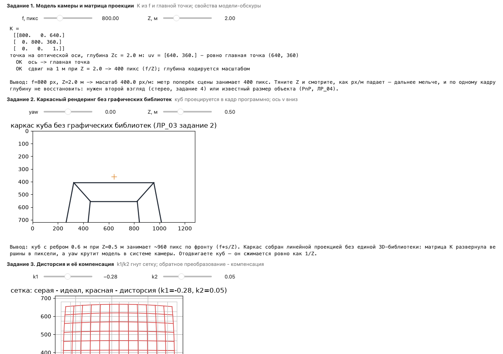

**ЛР_04 · Гомография, PnP, RANSAC.** Ползунок «шум, пикс» — и видно, где DLT
честно усредняет шум, а где начинает ошибаться; рядом — нормировка Хартли
(`cond` матрицы плана падает с 1.7e+06 до 136, а точность почти не меняется);
ниже — поза из H и наложение куба по AR.

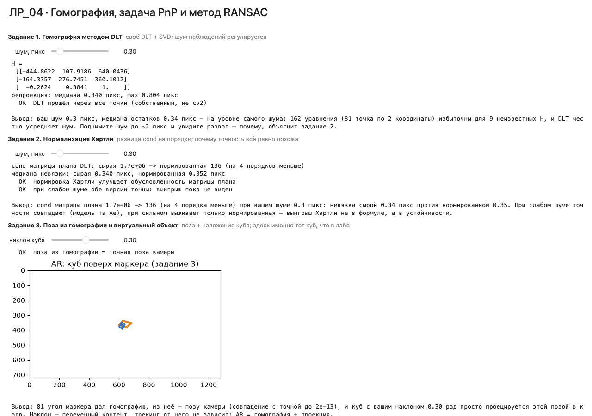

**ЛР_05 · DH-параметры и FK.** Четыре параметра `a, alpha, d, theta` собираются
в одну матрицу; ниже — плоский 3R-рукав: цепочка DH-матриц и замкнутая формула
с накоплением углов сходятся до 2e-16, там же — компилированная (lambdify)
форма против векторизованного NumPy.

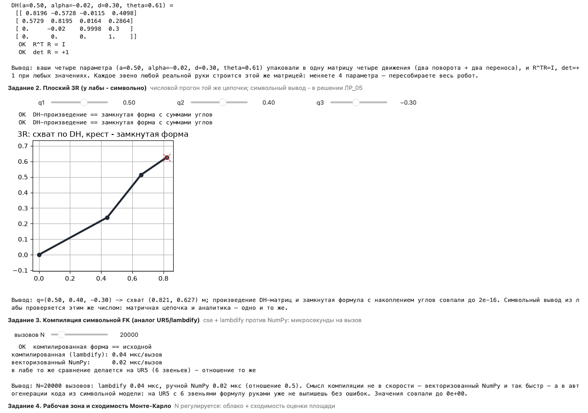

**ЛР_06 · Обратная кинематика.** Кольцо достижимости и **две ветви**
аналитического решения («локоть вверх» / «локоть вниз»): на графике обе ветви
ведут в одну цель. Семя решает, в какую ветвь попадёт Ньютон — печатается
число итераций, невязка и отношение `r_n/r_(n-2)` (квадратичная сходимость).

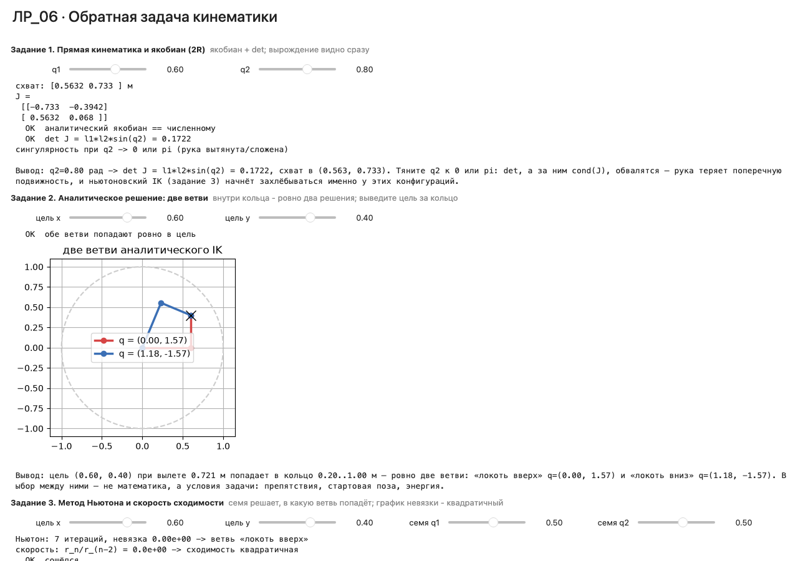

**Сводная сцена** — все шесть лаб в одном контуре: `пиксели → поза маркера →
дерево кадров → перелёт → FK → IK`. Таблица вверху говорит, из какого задания
взята каждая формула; режим переключается кнопкой («ручной (суставы)» /
«цель (IK)»).

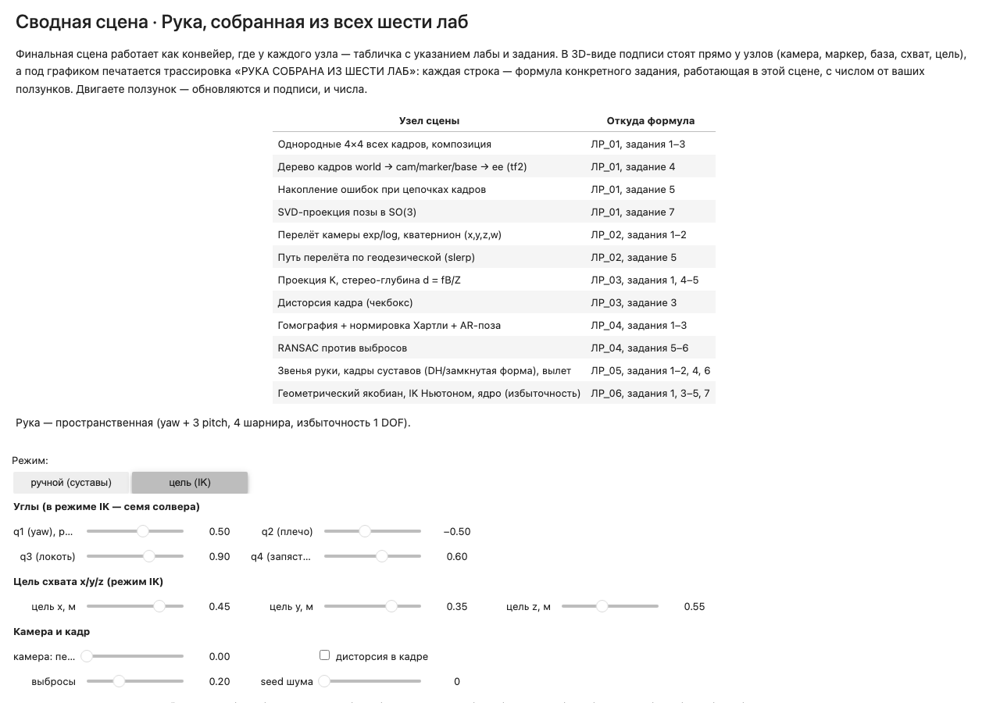

Под панелью — сама сцена: слева 3D (подписи у узлов — какой узел какой лабы),
справа кадр камеры (маркер, инлаеры, цель, выбросы). Ниже печатается
трассировка «рука собрана из шести лаб» с числами от ваших ползунков.

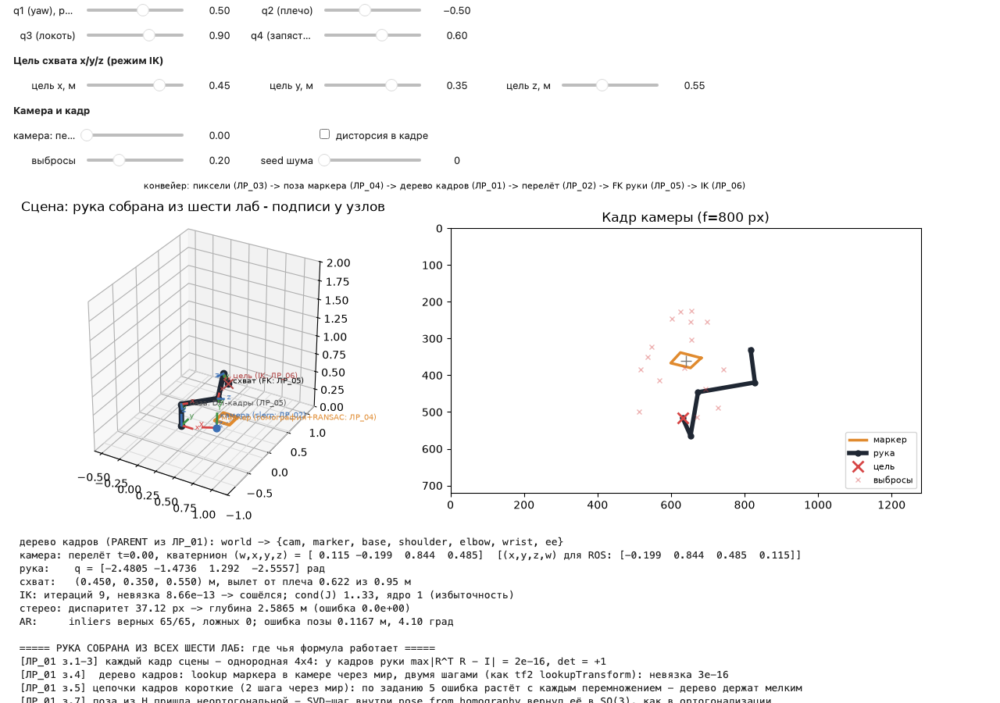

Всё это можно проверить одним прогоном: последний блок («Автотест конвейера»)
прогоняет те же формулы в жёстких сценариях и печатает `ВСЕ ПРОВЕРКИ ПРОЙДЕНЫ`.

---

## Мост: панель ноутбука крутит ROS-руку

Внизу ноутбука — секция «Мост в ROS-стенд». Отмечаете галочку — и каждое
движение ползунков `q1..q4`, цели `x/y/z` и перелёта камеры уходит по TCP
в `bridge_server`, который превращает их в `/joint_states`, `/goal_pose` и
`/stand/cam_t`. Переключатель «куда слать» выбирает порт: **8977** — полный
стенд, **8177** — лёгкий мост; при старте ячейка сама пингует оба и
подключается к тому, что живо. Без поднятого стенда ячейка печатает подсказку
и ничего не ломает.

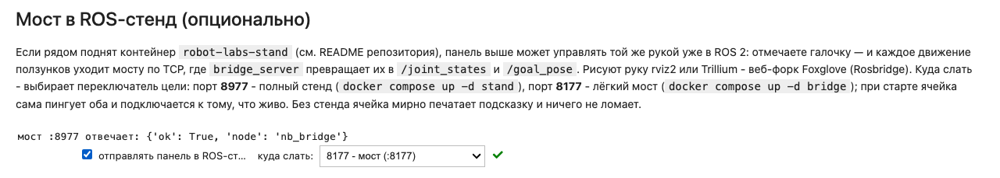

Строчка `мост :8977 отвечает: {'ok': True, 'node': 'nb_bridge'}` — результат
стартового пинга: ячейка при запуске пробует оба порта. Куда слать фактически —
выбирает переключатель (на кадре выбран **8177**), а зелёная галочка справа —
`W.Valid`: пинг на выбранный порт ответил, связь есть.

Как это выглядит снаружи. Рука в просмотрщике (он подключён к rosbridge
лёгкого моста, `ws://localhost:9190`) **до** включения галочки:

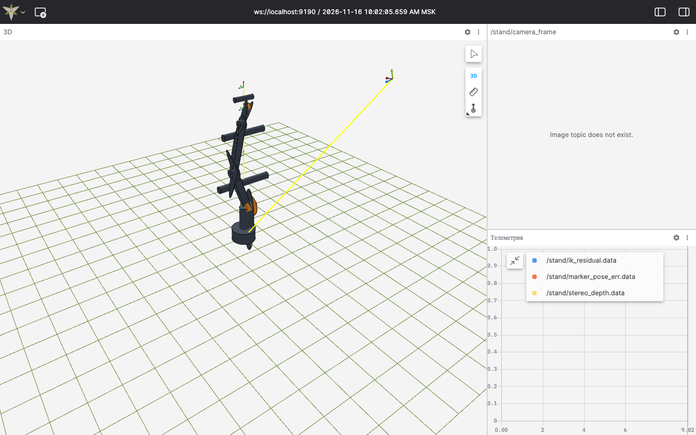

Те же ползунки панели (`q2` → 2.00, `q3` → −2.20) — и в том же окне рука
перестроилась следом. Никакой прослойки между ноутбуком и ROS: TCP + один
JSON на сообщение. Панели `Image` и `Телеметрия` в этом кадре пустые
по смыслу: в лёгком мосте нет ни трекинга, ни IK-сервера — только рука.

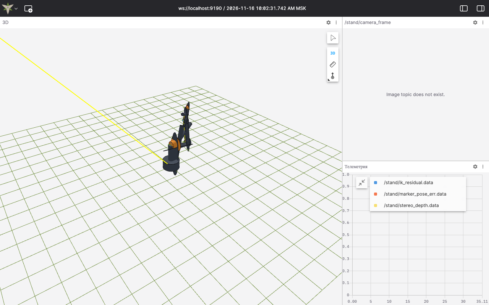

Проверить мост можно и без ноутбука — протокол один JSON-команд:

```bash
printf '{"q": [0.6, -0.5, 0.8, -0.3]}' | nc localhost 8177
```

---

## ROS-стенд в браузере: Trillium

```bash
docker compose -f docker/docker-compose.yml up -d viewer
# → http://localhost:8080
```

Приложение открывается на пустой сцене с диалогом выбора источника данных:

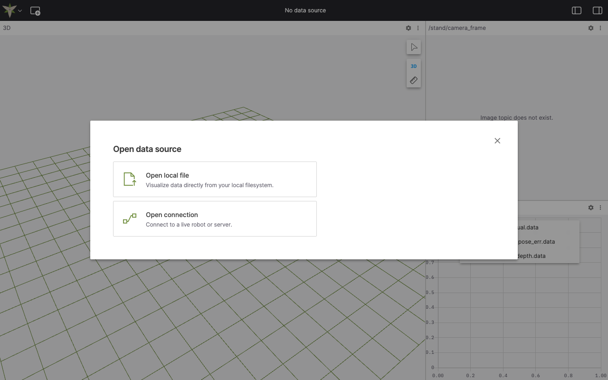

Нужен **Open connection** → тип **Rosbridge** → адрес `ws://localhost:9090`
(для моста — `ws://localhost:9190`):

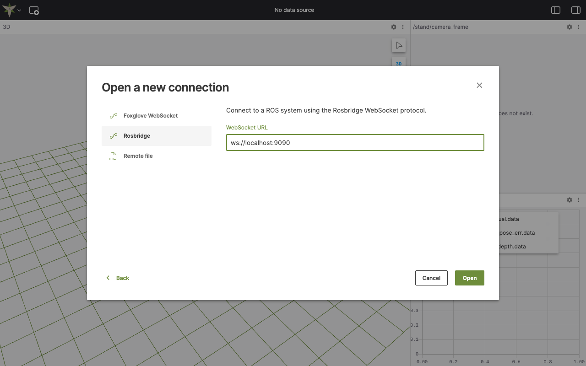

После «Open» появляется вся раскладка — **настраивать ничего не нужно**,
она зашита в контейнер (`docker/trillium-layout.json`):

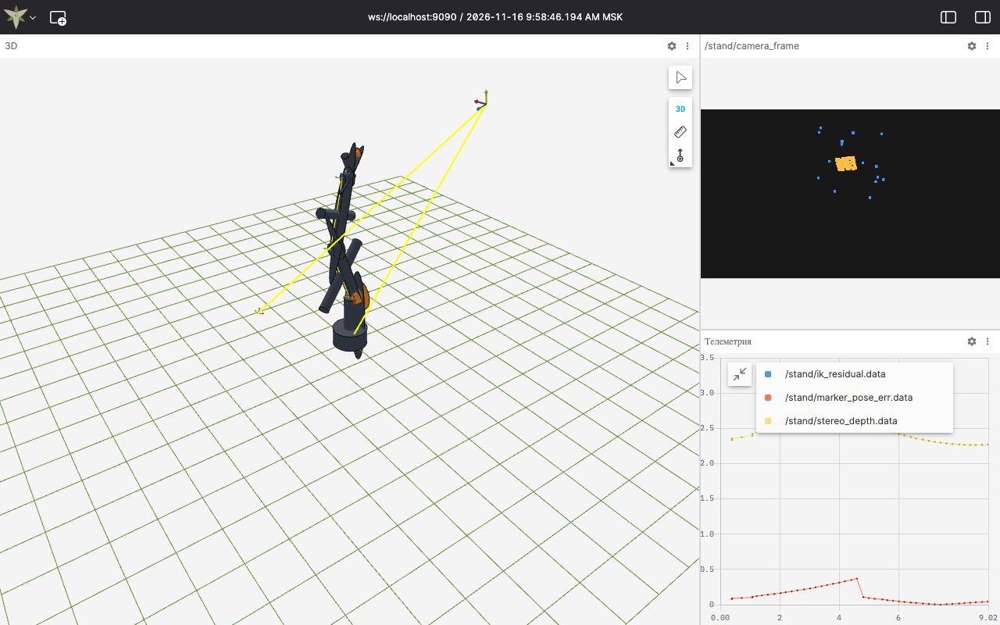

Что где:

- **3D слева** — рука: URDF из `/robot_description`, расставленный
  `robot_state_publisher`-ом по `/joint_states` в TF, плюс `/stand/arm_markers`
  (сферы и цилиндры звеньев), оси TF, сетка, fixed frame `world`. Жёлтая
  пирамида — направление взгляда камеры: вершина в TF-кадре `camera`
  (его двигает `camera_flight`), основание смотрит на маркер.
- **Image справа сверху** — кадр `/stand/camera_frame`: наблюдения, из которых
  трекинг собирает позу маркера.
- **Телеметрия справа снизу** — `/stand/ik_residual`,
  `/stand/marker_pose_err`, `/stand/stereo_depth`.

Синим на кадр нарисованы **все** наблюдения сетки маркера, оранжевым — те из
них, что RANSAC оставил инлаерами; разбросанные вокруг синие пятна — выбросы,
которые метод отбросил (по умолчанию 20%):

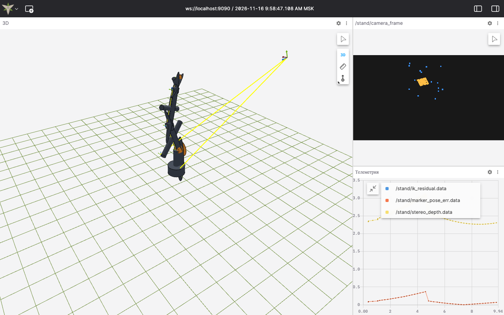

В маленькой панели пятна читаются плохо — колесо мыши внутри панели
приближает кадр («Reset view» возвращает как было):

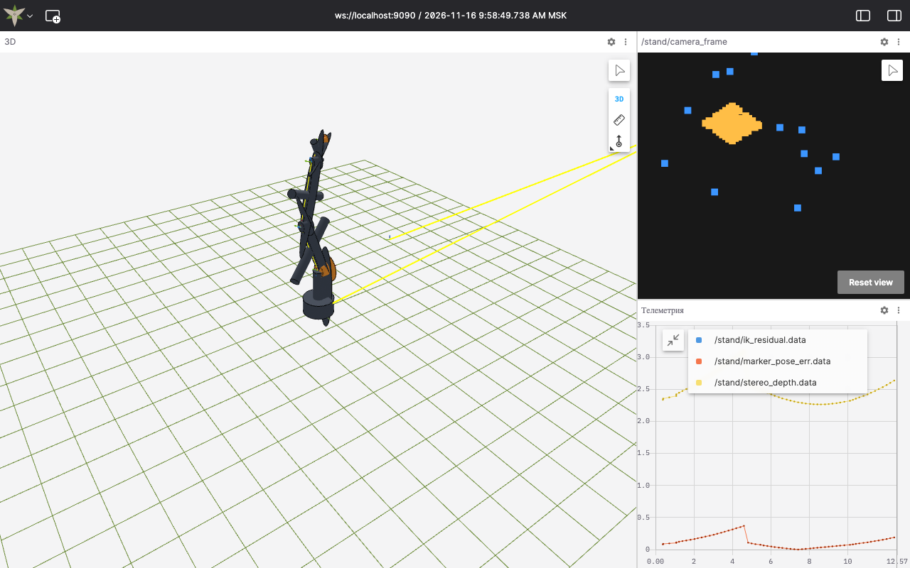

**Руку можно двигать мышкой.** В тулбаре 3D-панели (справа сверху, в узкой
панели прижат к краю) нажмите «Publish pose» — появится плашка
«Click to cancel»:

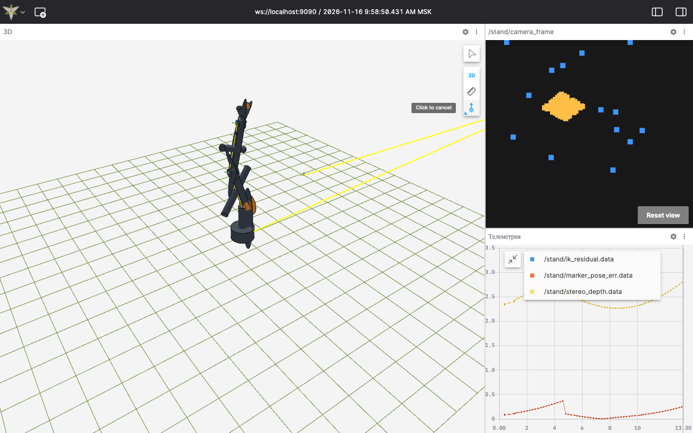

В режиме `pose` цель задаётся **двумя кликами**: первый — положение, второй —
направление оси X. Кнопка после публикации сбрасывается, для новой цели её
надо вооружить заново.

После клика по сетке публикуется `/move_base_simple/goal`, IK-сервер решает
обратную задачу и переставляет руку. Здесь цель — точка на полу около
(0.50, 0.35, 0), поэтому рука сложилась вниз:

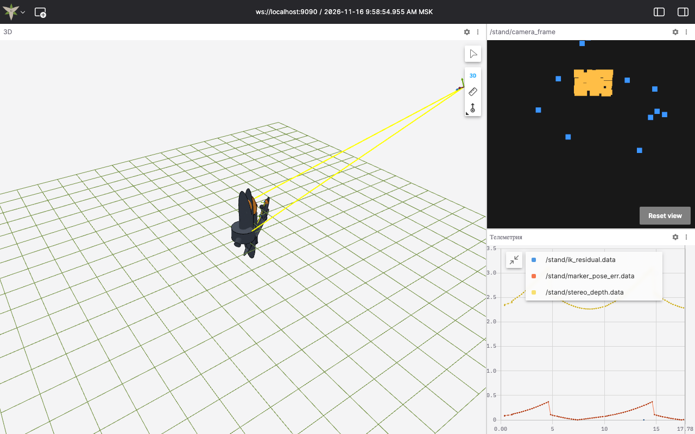

Телеметрия — то, за чем стоит смотреть:

- **невязка IK** (`/stand/ik_residual`) на этом масштабе не видна вовсе —
  она лежит на нулевой шкале (2.8e-16 против 3.5 по оси Y). Это и есть
  «решение сошлось»;
- **ошибка позы маркера** (`/stand/marker_pose_err`, красная) — в метрах:
  растёт, пока трекер уводит камеру к косому виду (цена ошибки глубины
  `Z²/(fB) × шум в пикселях` — дорожает вместе с `Z`), и обрывается вниз,
  когда `t` трекера делает цикл (шаг 0.02 на тик, период ~10 с);
- **стерео-глубина** (`/stand/stereo_depth`, жёлтая) — `d = fB/Z`, 2.2…2.6 м,
  дышит вместе с тем же перелётом.

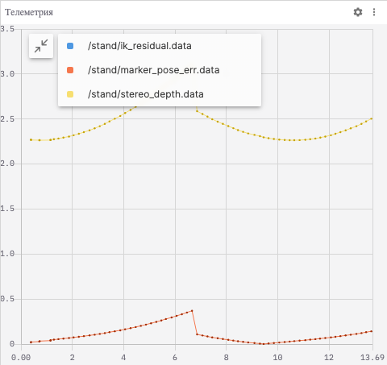

### Раскладка применяется один раз

Готовая раскладка берётся из `docker/trillium-layout.json`, но:

- **браузер** хранит раскладку в `localStorage` (ключ `studio.layout`). Если вы
  уже открывали `http://localhost:8080` раньше — один раз сбросьте её: F12 →
  консоль → `localStorage.clear()` → обновить страницу;
- **правка файла** видна после пересоздания контейнера, а не после `restart`
  (entrypoint образа встраивает раскладку в `index.html` один раз):
  `docker compose -f docker/docker-compose.yml up -d --force-recreate viewer`.

Дальше панели настраиваются мышью, как в любом Foxglove: топики, слои,
публикуемая тема, камера.

### Trillium — рекомендация, а не обязательная зависимость

- стенд поднимается и работает **без** `viewer`: все узлы, топики и мост
  живут в контейнере `stand`/`bridge`, просмотрщик — только глаза;
- вместо него подойдёт любой rosbridge-клиент: Foxglove, Lichtblick, свой
  клиент на `rosbridge_protocol`. Данных стенд от этого не меняет;
- [Trillium](https://github.com/pdragy/trillium) — опенсорсный веб-форк
  Foxglove Studio (ответвление от последней открытой ветки v1.87.0, лицензия
  MPL-2.0). Он выбран потому, что Foxglove в ряде регионов недоступен, а
  Trillium — это просто статика в браузере, без внешних сервисов: всё остаётся
  локально.
- в compose используется готовый образ `cloudv0/trillium:latest` (собирается
  из того же репозитория). Если он недоступен — Trillium можно не запускать
  контейнером, а открыть <https://pdragy.github.io/trillium/> и подключиться к
  `ws://127.0.0.1:9090`: `127.0.0.1` браузер считает защищённым источником, и
  смешанным контентом такая ссылка не считается. Либо собрать образ самому:
  `docker build -t trillium .` в клоне репозитория.

---

## Где чья лабораторная в ROS-стенде

| Узел стенда | Лаба | Что воспроизводит |
|---|---|---|
| `robot_state_publisher` + `urdf/stand_arm.urdf` | ЛР_01, 05 | дерево кадров, геометрия звеньев (0.45/0.35/0.15 м, база 0.30 м, вылет 0.95 м) |
| static tf `world→marker` | ЛР_01 з.4 | кадры хранятся деревом (tf2), как `lookupTransform` |
| `camera_flight` | ЛР_02 з.5 | перелёт камеры по slerp (та же геодезическая), кватернион в ROS-порядке (x,y,z,w) |
| `marker_tracker` | ЛР_04 з.1–3, 5; ЛР_03 з.1, 3–4 | проекция K, дисторсия, шум+выбросы, RANSAC-гомография с нормировкой Хартли, поза из H с SVD-проекцией в SO(3), стерео-глубина d = fB/Z |
| `ik_server` | ЛР_06 з.3–5 | ньютоновский IK с pinv, невязка и `cond(J)` на каждой итерации; недостижимая цель честно упирается в границу |
| `bridge_server` | мост | TCP: `/joint_states`, `/goal_pose`, `/stand/cam_t` |

Математика в стенде и в ноутбуке одна — `stand_math.py` перенесён из ноутбука
1:1, поэтому числа совпадают: IK одной и той же цели (0.45, 0.35, 0.55)
сходится с невязкой 8.7e-13 на панели ноутбука и 2.8e-16 в `ik_server`.

## Состав репозитория

```
notebooks/            Апофеоз_ЛР01-06.ipynb + лабы 01-06 (решения и шаблоны)
docs/                 Прикладные_блоки_и_проверки.md,
                      ROS2_проекция_на_лабораторные.md
docs/screenshots/     картинки этого README
docker/               Dockerfile.ros2, docker-compose.yml, run_stand.sh,
                      run_bridge.sh, trillium-layout.json (раскладка панелей)
ros2_ws/src/apotheosis_stand/
  apotheosis_stand/   узлы + stand_math.py (единая математика)
  urdf/stand_arm.urdf модель руки стенда
  launch/             stand.launch.py (состав узлов, параметры rosbridge)
  test/test_math.py   тесты ядра против эталонных чисел
```

## Проверка математики стенда (без Docker)

```bash
PYTHONPATH=ros2_ws/src/apotheosis_stand \
  python3 -m pytest ros2_ws/src/apotheosis_stand/test -q
```

Покрывает шесть свойств ядра: вылет FK (`0.95` м), якобиан против численной
производной, сходимость IK на случайных целях (невязка < 1e-9), геодезичность
slerp, ROS-порядок кватерниона `(x, y, z, w)`, стерео-формулу `Z = fB/d`.

## Известные ограничения

- Стенд **не** использует реальную камеру: кадры синтетические — задача стенда
  воспроизвести математику лабораторных в индустриальном каркасе ROS 2, а не
  съёмку.
- rviz2 внутри контейнера требует X-сервер на хосте; из коробки рекомендуется
  просмотрщик в браузере через rosbridge (без X11).
- порты публикуются правилами `docker compose` на все интерфейсы
  (`0.0.0.0:9090`), то есть стенд видно из локальной сети. Если это не нужно,
  завяжите на петлю: `- "127.0.0.1:${ROSBRIDGE_PORT:-9090}:9090"` в
  `docker/docker-compose.yml`;
- `viewer` собирается под `linux/amd64`: на Apple Silicon стартует через
  Rosetta (внутри — статика на Caddy, оверхед эмуляции не заметен).
